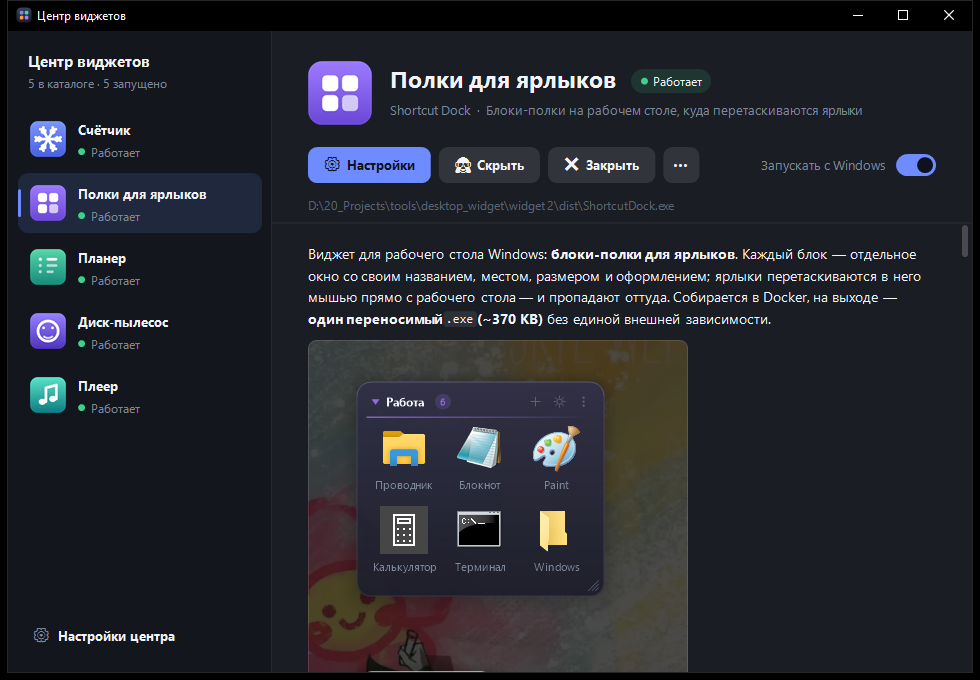

# Центр виджетов (WidgetHub)

Одна программа и один значок в трее вместо отдельного значка у каждого виджета — сколько бы
их ни было. Список берётся из `catalog.json`, новый виджет — одна запись в нём. Слева — все виджеты серии и их состояние,
справа — страница выбранного: описание и скриншоты из его README, кнопки «Скачать»,
«Запустить», «Настройки», «Скрыть», «Закрыть» и переключатель автозапуска.



Стек тот же, что у виджетов: C++17 + Win32 + GDI+, кросс-компиляция MinGW-w64 в Docker,
один статически слинкованный `.exe`. README, скриншоты и иконки виджетов вшиты в него —
описание видно, даже когда сами виджеты ещё не скачаны и интернета нет.

---

## Быстрый старт

```powershell
.\hub\scripts\build.ps1     # соберёт hub\dist\WidgetHub.exe (нужен Docker Desktop)
.\hub\dist\WidgetHub.exe
```

Центр, запущенный прямо из репозитория, сам находит свежие сборки в `widget N\dist\` —
скачивать ничего не нужно. На другом компьютере достаточно одного `WidgetHub.exe`:
виджеты он скачает из релиза GitHub.

---

## Что умеет

| Действие | Как |
|---|---|
| Скачать виджет | Кнопка **«Скачать»** — файл берётся из последнего релиза GitHub и кладётся в `%LOCALAPPDATA%\WidgetHub\widgets` |
| Обновить | `⋯` → **«Обновить из GitHub»**. Работающий виджет закрывается (сохранив данные), файл подменяется, виджет запускается снова |
| Запустить / закрыть | **«Запустить»**, **«Закрыть»** на странице или в меню значка центра |
| Настройки виджета | **«Настройки»** открывают его собственное окно настроек. У счётчика (виджет 1) окна настроек нет — открывается его меню |
| Спрятать блоки | **«Скрыть»** / **«Показать»** — то же, что двойной клик по значку виджета раньше |
| Автозапуск | Переключатель **«Запускать с Windows»** — та же запись в реестре, что и галочка в настройках самого виджета |
| Свой файл | **«Указать файл»** или `⋯` → **«Указать файл вручную…»** — если виджет лежит где-то ещё |

### Один значок в трее

Пока центр работает, виджеты не ставят свои значки: всё управление — в окне центра и в
меню его значка (правый клик: подменю на каждый виджет — показать, скрыть, настройки,
закрыть, запустить). Виджет, запущенный мимо центра — автозапуском или двойным кликом, —
центр замечает в течение секунды и тоже просит спрятать значок.

При выходе из центра (**«Выход»** в меню значка) значки виджетов возвращаются в трей —
иначе ими было бы не управлять. Крестик окна по умолчанию только прячет центр в трей.

### Откуда скачиваются виджеты

В настройках центра указывается репозиторий GitHub в виде `владелец/репозиторий` (можно
вставить и ссылку целиком — центр сам вырежет нужное). Виджет качается по адресу

```
https://github.com/<владелец>/<репозиторий>/releases/latest/download/<Имя>.exe
```

то есть из **последнего** релиза, файлом с тем же именем, что и в `catalog.json`
(`TuneBox.exe`, `PlannerGo.exe`…). Перед заменой центр проверяет, что пришёл именно
`.exe`, а не страница с ошибкой.

Выложить релиз со всеми `.exe` разом:

```powershell
.\hub\scripts\release.ps1 -DryRun   # проверить список
.\hub\scripts\release.ps1           # выложить v<VERSION> в namalkin/desktophub
```

`gh` не нужен: скрипт ходит в REST API GitHub с тем входом, который git сохранил при
`git push`, и перед выпуском проверяет, что это аккаунт `namalkin`.

### Обновления

Центр проверяет последний релиз при запуске и раз в 6 часов (и по кнопке **«Проверить»**
в настройках).

- **Сам центр** сравнивает свою версию с тегом релиза. Если релиз новее, в боковой панели
  появляется плашка «Центр vX.Y.Z», а в меню значка — «Обновить центр». По клику центр
  скачивает новый `WidgetHub.exe`, отодвигает себя в `WidgetHub.exe.old` (запущенный файл
  Windows переименовать разрешает), ставит новый на место и перезапускается. Новый центр
  ждёт, пока старый выйдет, и удаляет `.old`.
- **Виджеты** сравниваются по содержимому: GitHub отдаёт SHA-256 каждого файла релиза, центр
  считает хеш локального `.exe`. Не совпало — у виджета в списке метка «обновление», на его
  странице кнопка **«Обновить»**. Так видно и виджет, поставленный мимо центра.

Центр, запущенный из `hub\dist` репозитория, себя не заменяет — это сборка разработчика;
вместо этого плашка открывает страницу релиза.

Версия одна на весь репозиторий — файл `VERSION` в корне. Сборка вшивает её в центр,
`release.ps1` ставит тег `v<VERSION>` и откажется выпускать релиз, если центр собран до
последней правки `VERSION`: иначе центр вечно считал бы себя устаревшим.

### Где центр ищет виджет

1. путь работающего процесса;
2. путь, который центр запомнил (скачанный или указанный вручную);
3. запись автозапуска виджета в `HKCU\...\Run`;
4. `%LOCALAPPDATA%\WidgetHub\widgets\`;
5. папка рядом с `WidgetHub.exe`;
6. `widget N\dist\` — если центр запущен из `hub\dist` репозитория.

## Настройки

Тема и акцент, репозиторий GitHub, папка для скачанных виджетов, автозапуск центра
с Windows (центр стартует свёрнутым в трей) и поведение крестика. Хранятся в
`%APPDATA%\WidgetHub\data.json`.

---

## Как устроен код

| Файл | За что отвечает |
|---|---|
| `main.cpp` | WinMain, единственный экземпляр, COM и GDI+ |
| `hub.cpp` | Окно центра: список, страница виджета, настройки, трей, мышь и клавиатура |
| `catalog.cpp` | Вшитый каталог: `catalog.json`, README, картинки и иконки из ресурса `catalog.pak` |
| `markdown.cpp` | README на странице: разбор Markdown, перенос строк, таблицы, картинки, ссылки |
| `control.cpp` | Поиск окна виджета, запрос состояния, запуск, закрытие с ожиданием |
| `download.cpp` | Загрузка из релиза GitHub (WinINet) в фоновом потоке и подмена файла, в том числе самого центра |
| `update.cpp` | Проверка последнего релиза: версия центра, SHA-256 файлов виджетов |
| `hub_link.h` | Протокол «центр ↔ виджет» — тот же файл лежит в `src\` каждого виджета |
| `store.cpp`, `sys.cpp`, `util.cpp`, `json.cpp`, `ui.cpp` | Настройки, реестр и трей, пути, JSON, палитра и GDI+ |

### Протокол центра и виджета

Центр находит виджет по классу его скрытого окна верхнего уровня (`TuneBoxOwner`,
`PlannerGoApp`… — поле `window` в `catalog.json`) и шлёт ему зарегистрированное
сообщение `DesktopWidgets_Hub` с командой в `wParam`: показать, спрятать, открыть
настройки, закрыться, убрать или вернуть значок в трее. Состояние спрашивается через
`SendMessageTimeout` (300 мс — зависший виджет не подвешивает центр): ответ говорит,
что виджет понимает протокол и видны ли его блоки. Сборка без протокола отвечает нулём —
центр помечает её «старой» и предлагает обновить.

Команды с интерфейсом (меню, окно настроек) идут через `PostMessage`, а не `SendMessage`:
иначе центр ждал бы, пока пользователь закроет меню виджета. Перед ними центр вызывает
`AllowSetForegroundWindow`, чтобы окно настроек виджета вышло поверх центра.

### Почему каталог вшит в .exe

README и скриншоты нужны центру ещё до того, как виджет скачан, и без интернета.
`tools/pack.py` во время сборки складывает `catalog.json`, README, картинки, на которые
README ссылается, и иконки виджетов в один файл `catalog.pak`, а тот уходит в `.exe`
ресурсом. Разделы README для разработчика («Сборка», «Как устроен код», «Что проверено»…)
центр не показывает — их читает тот, кто собирает, а не тот, кто пользуется.

Новый виджет добавляется одной записью в `hub\catalog.json` и копией `hub_link.h` с
обработкой команд в его `src\`.

---

## Сборка

```powershell
.\hub\scripts\build.ps1                 # Windows + Docker Desktop
```

```sh
./hub/scripts/build.sh                  # Linux / macOS / Git Bash
```

Контекст Docker — корень репозитория (центру нужны README всех виджетов), а лишнее
отсекает `hub\Dockerfile.dockerignore`. Иконка рисуется отдельно и лежит в репозитории:

```powershell
.\hub\scripts\make-icon.ps1             # перерисует hub\res\app.ico
```
