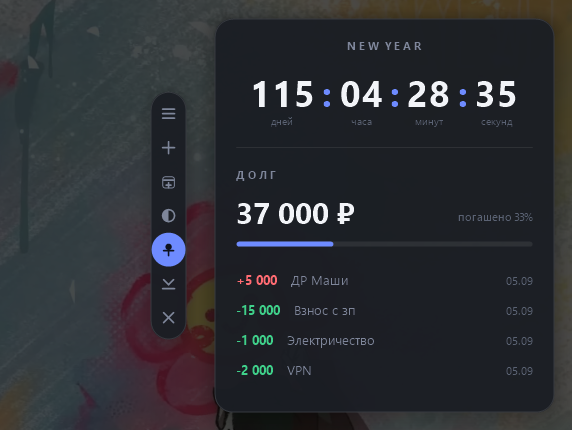

# New Year Widget

Виджет для рабочего стола Windows: обратный отсчёт до события и учёт долга по нему.
Событий может быть несколько, и у каждого свой долг со своим списком операций;
сумму можно закрыть звёздочками, чтобы её не видел никто, кроме вас.
Собирается в Docker, на выходе — **один переносимый `.exe` (~317 KB)** без единой внешней зависимости.



---

## Быстрый старт

```powershell
# из корня проекта
docker build --target export --output "type=local,dest=dist" .
```

Появится `dist\NewYearWidget.exe`. Скопируйте его на любую Windows 10/11 машину и запустите двойным кликом.

Альтернативы:

```powershell
.\scripts\build.ps1           # то же самое + проверки и размер файла
docker compose run --rm build # через docker-compose, результат тоже в dist/
```

> Перед пересборкой закройте запущенный виджет: Windows блокирует запущенный `.exe`,
> и запись в `dist/` завершится ошибкой «Permission denied».

На целевой машине **не нужны** Node.js, Python, .NET, Java, браузер, Docker и установщик.
Проверенный список импортов `.exe`: `KERNEL32`, `USER32`, `GDI32`, `gdiplus`, `SHELL32`, `ole32`, `msvcrt` —
все они входят в состав Windows.

---

## Выбор стека

| Вариант | Размер `.exe` | Что нужно на целевой машине | Вердикт |
|---|---|---|---|
| **C++17 + Win32 + GDI+ (MinGW-w64, статическая линковка)** | **~317 KB** | ничего | **выбран** |
| Rust + `windows-sys` | ~0.5–1.5 MB | ничего | рабочий вариант, но GUI-код объёмнее, а выигрыша нет |
| Tauri / WebView2 | ~3 MB | **WebView2 Runtime** | нарушает требование «без установки зависимостей» |
| Electron | 80+ MB | — | исключён требованием к размеру |

Почему именно так:

- **Win32 + GDI+** — весь UI рисуется средствами, уже встроенными в Windows; ни одной сторонней библиотеки.
- **MinGW-w64** кросс-компилирует Windows-бинарник из Linux-контейнера, поэтому Docker Desktop собирает
  проект без Windows-контейнеров (их поддержка есть не у всех и требует переключения движка).
- **`-static`** вкомпилирует `libstdc++`/`libgcc`/`winpthread` внутрь — на целевой машине не нужен ни один DLL.
- Окно слоёное (`WS_EX_LAYERED` + `UpdateLayeredWindow`), поэтому скруглённые углы и тень получаются
  с настоящим альфа-каналом и сглаживанием, одинаково на Windows 10 и 11.

---

## Структура проекта

```
widget/
├── CMakeLists.txt              сборка, флаги размера и статической линковки
├── Dockerfile                  debian + mingw-w64 -> .exe (multi-stage)
├── docker-compose.yml          вариант сборки с выводом в ./dist
├── cmake/
│   └── toolchain-mingw.cmake   кросс-компиляция Linux -> Windows x64
├── res/
│   ├── app.rc                  версия, манифест, иконка
│   ├── app.manifest            per-monitor DPI, совместимость с Win10/11
│   └── app.ico                 иконка приложения и трея (генерируется скриптом)
├── scripts/
│   ├── build.ps1               сборка из PowerShell
│   ├── build.sh                сборка из sh/Git Bash
│   └── make-icon.ps1           генерация res/app.ico
├── src/
│   ├── main.cpp                WinMain, инициализация GDI+, один экземпляр
│   ├── widget.h/.cpp           окно виджета: раскладка, отрисовка, панель кнопок, меню
│   ├── dialog.h/.cpp           модальное окно ввода с произвольным набором полей
│   ├── store.h/.cpp            модель данных, атомарная запись, резервные копии
│   ├── csv.h/.cpp              экспорт и импорт CSV
│   ├── sys.h/.cpp              автозапуск, значок в трее, открытие папок
│   ├── json.h/.cpp             минимальный JSON-парсер и сериализатор
│   ├── ui.h/.cpp               палитра (темы и акценты), DPI, обёртки над GDI+
│   └── util.h/.cpp             кодировки, пути, формат и разбор сумм и дат
└── dist/
    └── NewYearWidget.exe       результат сборки
```

Иконка лежит в репозитории готовой: сборка идёт в Linux-контейнере, где `System.Drawing` нет.
Перегенерировать её (только при смене дизайна) — `.\scripts\make-icon.ps1`.

---

## Как пользоваться

Слева от карточки — панель быстрых кнопок. При наведении на кнопку слева появляется подпись,
что она делает, а включённый переключатель («Поверх всех окон») заливается акцентным цветом.
Широкой кнопки «Добавить операцию» внизу карточки нет: то же самое делает кнопка **+** на панели
и горячая клавиша, а карточка от этого стала компактнее.

| Кнопка | Действие |
|---|---|
| ≡ | всё меню: события, оформление, данные, автозапуск |
| **+** | добавить операцию |
| 🗓 | добавить событие |
| ◐ | переключить светлую/тёмную тему |
| 📌 | поверх всех окон (вкл/выкл) |
| ⌄ | свернуть в трей |
| ✕ | закрыть виджет |

Остальное:

| Действие | Как |
|---|---|
| Переместить виджет | зажать любое пустое место карточки и тянуть |
| Добавить операцию | кнопка **+** на панели, пункт меню ≡ или **Ctrl+Alt+N** |
| Изменить операцию | двойной клик по строке |
| Удалить операцию | навести на строку → крестик справа |
| Изменить начальный долг | клик по сумме долга (меняется долг текущего события) |
| Переключить событие | клик по заголовку карточки — вместе с ним меняются долг и список операций |
| Скрыть сумму долга | ≡ → «Скрывать сумму долга»; сумма показывается при наведении на неё |
| Добавить/изменить событие | ≡ → «События» |
| Прокрутить список | колесо мыши (показываются 6 последних операций) |
| Вернуть из трея | двойной клик по значку в трее |

Полное меню (кнопка ≡ или правый клик по карточке) содержит ещё: выбор акцентного цвета
и непрозрачности, экспорт и импорт CSV, папку с данными и резервными копиями, очистку списка,
автозапуск вместе с Windows и включение горячей клавиши.

### Виджет как часть рабочего стола

В режиме «на рабочем столе» виджет — **дочернее окно самого стола** (`Progman`): не просто лежит
под чужими окнами, а физически находится внутри стола, рядом со значками. Поэтому он никогда не
всплывает над проводником, браузером или игрой — даже когда по рабочему столу кликнули мышью или
это второй монитор, — и при этом остаётся виден при «Показать рабочий стол» (Win+D), потому что
виден сам стол. В Alt+Tab виджет не появляется. Кнопка 📌 возвращает обычное окно «поверх всех».

Плата за это — две вещи, которые пришлось взять на себя:

- **окно двигает не система, а виджет.** Дочерние окна `WM_NCLBUTTONDOWN`/`HTCAPTION` не
  переносит, поэтому перенос ведёт таймер: пока нажата левая кнопка, виджет сам читает курсор и
  двигает окно. Захват мыши (`SetCapture`) тут не помощник — у неактивного окна он работает,
  лишь пока курсор над ним, а при переносе курсор постоянно оказывается за краем;
- **меню, диалоги и значок в трее принадлежат скрытому окну приложения.** Сделать владельцем
  само окно виджета нельзя: владельцем стал бы рабочий стол, и на время диалога он оказался бы
  отключён. Диалоги при этом центрируются по виджету, как и раньше.

Две мелочи, дорого давшиеся:

- сообщение оболочке «перестрой слой обоев» (`0x052C`) слать **не нужно**: оно заставляет
  рабочий стол перерисоваться, и виджет поверх него заметно мерцает;
- при смене родителя слоёное окно перестаёт показываться, пока `WS_EX_LAYERED` не выставлен
  заново. Без этого виджет после переключения «Поверх всех окон» выглядит исчезнувшим: окно на
  месте, «видимо», но полностью прозрачно. Поэтому переезд идёт через один метод `Reparent`:
  стиль → `SetParent` → пересборка `WS_EX_LAYERED` → `ShowWindow` → отрисовка.

### События и календарь

Событий может быть сколько угодно: Новый год, отпуск, дедлайн — каждое со своим названием, датой
**и своим долгом**. Отпуск и ремонт — разные деньги, поэтому у каждого события собственный
начальный долг и собственный список операций: переключили заголовок — сменились и сумма, и список,
и проценты погашения. Начальный долг спрашивается прямо в окне создания события, у нового
события он начинается с нуля.

- **Переключение** — клик по заголовку карточки листает события по кругу. Точки под заголовком
  показывают, сколько всего событий и какое открыто (появляются, начиная со второго).
- **Список и управление** — ≡ → «События»: выбрать любое, «Добавить событие…»,
  «Изменить текущее…», «Удалить текущее» (единственное событие удалить нельзя).
- **Дата выбирается в календаре**: месяц листается стрелками ‹ ›, сегодняшний день обведён,
  выбранный залит акцентом, выходные приглушены. Кнопка **«Без даты — до Нового года»** возвращает
  режим ближайшего 1 января с автопереходом на следующий год.
- Когда дата события наступила, вместо счётчика появляется надпись «событие наступило».

Календарь нарисован виджетом, а не взят из системы: системный `SysMonthCal32` не умеет тёмную тему
и выбивался бы из оформления карточки.

### Если сумму видеть не должны

≡ → **«Скрывать сумму долга»**. Вместо цифр карточка показывает `✳✳✳✳✳ ₽` и подпись
«наведите, чтобы увидеть»; настоящая сумма появляется, только когда курсор на ней. Проценты
погашения при этом тоже прячутся, а подсказка в трее пишет «сумма скрыта».

Суммы операций в списке остаются видны — их прятать смысла нет, по одной строке долг не
восстановить.

### Как считается долг

```
текущий долг события = initialDebt события + сумма его операций
```

`-` — выплата, долг уменьшается (зелёный цвет).
`+` — долг вырос (красный цвет).
Отдельно выбирать тип операции не нужно — направление задаёт знак суммы.

Пример из коробки:

```
начальный долг       50 000
-2000  VPN        => 48 000
-1000  Электричество => 47 000
-15000 Взнос с зп    => 32 000
+5000  ДР Маши       => 37 000
```

Поле «Сумма» понимает `-2000`, `+5 000`, `1000,50`, `1000.5`; пробелы и разделители тысяч игнорируются.

### Как изменить начальный долг

Кликните по сумме долга на карточке (при наведении справа появляется подсказка «изменить») —
или правый клик по виджету → **«Изменить начальный долг»**. Меняется долг **текущего** события;
значение сразу сохраняется в `data.json`.

---

## Где лежат данные

```
%APPDATA%\NewYearWidget\data.json
```

то есть `C:\Users\<имя>\AppData\Roaming\NewYearWidget\data.json`.

```json
{
  "goals": [
    {
      "title": "NEW YEAR",
      "date": "",
      "initialDebt": 50000,
      "transactions": [
        { "amount": -2000, "description": "VPN", "date": "2026-09-05" }
      ]
    },
    {
      "title": "ОТПУСК",
      "date": "2026-10-15",
      "initialDebt": 12000,
      "transactions": []
    }
  ],
  "activeGoal": 0,
  "appearance": { "theme": "dark", "accent": 0, "opacity": 100 },
  "hotkey": true,
  "hideDebt": false,
  "window": { "x": 1254, "y": 25, "alwaysOnTop": false }
}
```

- Файл в UTF-8, его можно править вручную (виджет при этом должен быть закрыт).
- Запись атомарная: сначала `data.json.tmp`, затем замена — данные не теряются при сбое.
- Позиция окна, тема и настройки хранятся там же, отдельного файла настроек нет.
- Долг и операции лежат внутри события: у каждого события они свои.
- Файлы прежних версий читаются без изменений: старые общие `initialDebt` и `transactions`
  из корня достаются первому событию, остальные события начинают с нуля; старое одиночное
  поле `goal` подхватывается как список из одного события.
- Сервера, базы данных и сети нет вообще: `.exe` не открывает ни одного сокета.

### Резервные копии

Перед каждой записью виджет откладывает копию в `%APPDATA%\NewYearWidget\backups\` — один файл
в сутки, вида `data-2026-09-05.json`, хранятся последние 7. Открыть папку: ≡ → «Данные» →
«Резервные копии». Восстановление — скопировать нужный файл поверх `data.json` при закрытом виджете.

### Экспорт и импорт CSV

≡ → «Данные» → «Экспорт в CSV…» сохраняет операции в формате `Дата;Сумма;Описание`, в UTF-8 с BOM
и с десятичной запятой — Excel в русской локали открывает такой файл без настройки импорта.
«Импорт из CSV…» дописывает строки к текущему списку (не заменяет их); понимает разделители `;` и `,`,
запятую и точку в дробной части, строку заголовка пропускает.

### Автозапуск

≡ → «Запускать вместе с Windows» пишет путь к `.exe` в
`HKCU\Software\Microsoft\Windows\CurrentVersion\Run`. Права администратора не нужны, реестр машины
не затрагивается. Если перенести `.exe` в другую папку, галочка погаснет — включите её заново.

---

## Что проверено

- [x] `docker build` проходит без ручного вмешательства
- [x] на выходе Windows `.exe` (331 264 байта)
- [x] запускается без установки runtime — только системные DLL
- [x] консольное окно не появляется (`-mwindows`)
- [x] окно без рамки, со скруглёнными углами и тенью, поверх рабочего стола
- [x] отсчёт идёт каждую секунду по локальному времени; 1 января переключается на следующий год
- [x] произвольная дата события считается верно, прошедшая даёт «событие наступило»
- [x] календарь: листание месяцев, выбор дня, «без даты», сегодня обведён
- [x] несколько событий: добавление, переключение кликом по заголовку и через меню
- [x] у каждого события свой долг и свой список операций: переключение меняет сумму,
      операции и проценты погашения (проверено на «ОТПУСК» 32 000 ₽ и «РЕМОНТ» 9 000 ₽)
- [x] данные прежнего формата переезжают в первое событие без потерь (140 000 ₽ и 4 операции)
- [x] «Скрывать сумму долга»: вместо цифр звёздочки, при наведении сумма видна,
      в трее «сумма скрыта», суммы операций остаются на виду
- [x] долг считается верно (50 000 −2000 −1000 −15 000 +5000 = 37 000 ₽)
- [x] операции и позиция окна сохраняются между запусками
- [x] операции добавляются, редактируются и удаляются
- [x] панель кнопок: наведение подсвечивает кнопку и показывает подпись
- [x] светлая и тёмная темы, 4 акцента, непрозрачность 60–100 %
- [x] значок в трее, автозапуск (запись в реестр появляется и удаляется)
- [x] виджет виден после Win+D и никогда не всплывает над чужими окнами: он внутри рабочего
      стола, клик по столу (в том числе на втором мониторе) его не поднимает
- [x] горячая клавиша Ctrl+Alt+N открывает окно добавления
- [x] резервная копия создаётся при первой за сутки записи
- [x] интернет не нужен

Экспорт и импорт CSV проверялись вручную: системный диалог выбора файла требует настоящего клика,
автоматический тест для него не писался.

---

## Идеи для версии 3 (не реализованы)

1. История и статистика: график погашения по месяцам, средний платёж, прогноз даты закрытия долга.
2. Категории операций и фильтры, повторяющиеся платежи (VPN каждый месяц).
3. Несколько «кошельков»/долгов с переключением (события переключать уже можно).
4. Анимации: плавная смена цифр счётчика, появление новой строки в списке.
5. Настраиваемый размер карточки и выбор шрифта.
6. Время события, а не только дата (сейчас отсчёт идёт до полуночи выбранного дня).
7. Напоминание о платеже в заданный день месяца (всплывающее уведомление Windows).
8. Подпись `.exe` сертификатом, чтобы SmartScreen не показывал предупреждение.
   Требует платного code-signing сертификата на владельца — делается только вами:
   получить сертификат, затем `signtool sign /fd SHA256 /tr <timestamp-url> /td SHA256 NewYearWidget.exe`.
