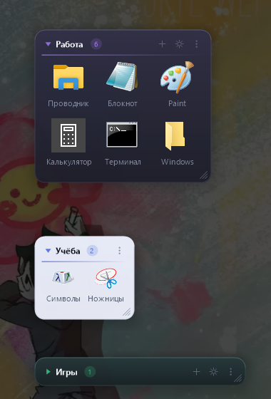

# Shortcut Dock

Виджет для рабочего стола Windows: **блоки-полки для ярлыков**. Каждый блок — отдельное окно
со своим названием, местом, размером и оформлением; ярлыки перетаскиваются в него мышью прямо
с рабочего стола — и пропадают оттуда. Собирается в Docker, на выходе — **один переносимый
`.exe` (~370 KB)** без единой внешней зависимости.



Коротко, что умеет:

- блоки живут на рабочем столе по отдельности: двигаются, сворачиваются, растягиваются мышью;
- лежат под окнами, как часть рабочего стола, и всплывают вместе с ним;
- у каждого блока своя тема (тёмная или светлая), акцент, непрозрачность и размер значков;
- акцент виден в оформлении: линия под заголовком, треугольник, счётчик и подсветка кнопок;
- ярлык переезжает в блок целиком — с рабочего стола он пропадает, а мышью его можно вынести обратно;
- принимает и «Корзину» с другими системными папками;
- настройки — отдельное окно с переключателями и ползунками, всё применяется сразу.

---

## Быстрый старт

```powershell
# из корня проекта
docker build --target export --output "type=local,dest=dist" .
```

Появится `dist\ShortcutDock.exe`. Скопируйте его на любую Windows 10/11 машину и запустите
двойным кликом. При первом запуске появится один пустой блок — перетащите в него ярлыки
с рабочего стола, дальше добавляйте блоки через меню или окно настроек.

Альтернативы:

```powershell
.\scripts\build.ps1           # то же самое + проверки и размер файла
docker compose run --rm build # через docker-compose, результат тоже в dist/
```

> Перед пересборкой закройте запущенный виджет: Windows блокирует запущенный `.exe`,
> и запись в `dist/` завершится ошибкой «Access is denied».

На целевой машине **не нужны** Node.js, Python, .NET, Java, браузер, Docker и установщик.
Проверенный список импортов `.exe`: `KERNEL32`, `USER32`, `GDI32`, `gdiplus`, `SHELL32`,
`ole32`, `comdlg32`, `ADVAPI32`, `msvcrt` — все они входят в состав Windows.

---

## Выбор стека

Тот же, что у виджета 1 (`../widget 1`): C++17 + Win32 + GDI+, кросс-компиляция MinGW-w64 из
Linux-контейнера, статическая линковка, слоёное окно (`WS_EX_LAYERED` + `UpdateLayeredWindow`)
ради настоящего альфа-канала, скруглённых углов и тени.

Что добавилось именно здесь:

- **Каждый блок — отдельное окно.** Так они двигаются по рабочему столу независимо, могут
  стоять в разных углах экрана и иметь разное оформление. Все окна ведёт один процесс: у него
  один значок в трее, одна горячая клавиша и один файл данных. Палитра ставится перед
  отрисовкой каждого блока, поэтому рядом спокойно живут тёмный и светлый.
- **`IDropTarget`, а не `WM_DROPFILES`.** Полноценный OLE-приёмник нужен, чтобы подсвечивать
  блок и показывать место вставки ещё до того, как кнопку мыши отпустили. Эффект перетаскивания —
  `DROPEFFECT_LINK`: виджет запоминает ссылку, исходный ярлык проводник не трогает.
- **Значки берутся у оболочки** через `IShellItemImageFactory` (запасной путь — `SHGetFileInfo`),
  поэтому они настоящие, с альфа-каналом, в нужном для текущего DPI размере и кэшируются.
- **Окно настроек рисуется вручную** теми же средствами, что и блоки: тумблеры, ползунки и
  переключатель темы — обычные прямоугольники GDI+, никаких системных контролов и тем более
  сторонних библиотек.

---

## Структура проекта

```
widget 2/
├── CMakeLists.txt              сборка, флаги размера и статической линковки
├── Dockerfile                  debian + mingw-w64 -> .exe (multi-stage)
├── docker-compose.yml          вариант сборки с выводом в ./dist
├── cmake/
│   └── toolchain-mingw.cmake   кросс-компиляция Linux -> Windows x64
├── res/
│   ├── app.rc                  версия, манифест, иконка
│   ├── app.manifest            per-monitor DPI, asInvoker (иначе не примет перетаскивание)
│   └── app.ico                 иконка приложения и трея (генерируется скриптом)
├── scripts/
│   ├── build.ps1               сборка из PowerShell
│   ├── build.sh                сборка из sh/Git Bash
│   └── make-icon.ps1           генерация res/app.ico
├── src/
│   ├── main.cpp                WinMain, OleInitialize, GDI+, один экземпляр
│   ├── widget.h/.cpp           App (трей, горячая клавиша, данные) и Block (окно блока)
│   ├── settings.h/.cpp         окно настроек: тумблеры, ползунки, выбор темы и акцента
│   ├── dnd.h/.cpp              приём перетаскивания: IDropTarget, CF_HDROP, PIDL и ссылки
│   ├── dragout.h/.cpp          обратное перетаскивание: виджет как источник OLE
│   ├── icons.h/.cpp            значки файлов у оболочки Windows + кэш
│   ├── dialog.h/.cpp           модальное окно ввода (название блока, подпись ярлыка)
│   ├── store.h/.cpp            модель данных, атомарная запись, резервные копии
│   ├── sys.h/.cpp              автозапуск, трей, запуск ярлыков, чтение .lnk
│   ├── json.h/.cpp             минимальный JSON-парсер и сериализатор
│   ├── ui.h/.cpp               палитра (темы и акценты), DPI, обёртки над GDI+
│   └── util.h/.cpp             кодировки, пути, разбор имён файлов
└── dist/
    └── ShortcutDock.exe        результат сборки
```

Иконка лежит в репозитории готовой: сборка идёт в Linux-контейнере, где `System.Drawing` нет.
Перегенерировать её (только при смене дизайна) — `.\scripts\make-icon.ps1`.

---

## Как пользоваться

В заголовке блока: треугольник (свернуть), название, счётчик ярлыков и кнопки
**+** (добавить ярлык), **⚙** (настройки блока), **⋮** (меню блока). В узком блоке остаётся
только **⋮** — остальное там же, в меню.

| Действие | Как |
|---|---|
| Добавить ярлык | перетащить файл, папку, `.lnk`, «Корзину» или ссылку из браузера в любой блок |
| Скопировать, а не забрать | тянуть с зажатым **Ctrl** — ярлык останется и на рабочем столе |
| Добавить через диалог | **+** в заголовке блока или ⋮ → «Добавить ярлык…» |
| Запустить | один клик по значку |
| Меню ярлыка | кнопка **⋮** в углу значка при наведении или правый клик по значку |
| Свернуть/развернуть блок | клик по заголовку |
| Передвинуть блок | тянуть за заголовок или за пустое место блока |
| **Изменить размер блока** | тянуть правый край (ширина), нижний край (высота) или уголок |
| Переставить ярлык | тянуть значок — внутри блока или в соседний блок |
| **Вынести ярлык обратно** | тянуть значок за пределы блоков — на рабочий стол или в папку |
| **Выделить несколько** | **Ctrl+клик** по значкам; дальше вся пачка тащится и переносится вместе |
| **Закрепить блок** | ⋮ → «Закрепить блок»: не двигается и не тянется, в заголовке замочек |
| Новый блок | ⋮ → «Новый блок…», кнопка в настройках виджета или меню значка в трее |
| Переименовать блок | ⋮ → «Переименовать блок…» |
| Удалить блок | ⋮ → «Удалить этот блок» (последний блок удалить нельзя) |
| Настройки блока | **⚙** в заголовке или ⋮ → «Настройки блока…» |
| Настройки виджета | **клик по значку в трее**, ⋮ → «Настройки виджета…» |
| Прокрутить блок | колесо мыши (когда рядов больше, чем видно) |
| Скрыть/показать все блоки | **Ctrl+Alt+D** или пункт меню значка в трее |

Меню ярлыка: открыть, запуск от имени администратора, показать в проводнике, свойства файла,
переименовать (и задать аргументы командной строки), переместить в другой блок, убрать из блока.

### Размер блока мышью

Ширина считается в значках, высота — в рядах, поэтому блок «щёлкает» по сетке и всегда остаётся
ровным:

- правый край — от 1 до 12 значков в ряду (да, блок шириной в один значок — это нормально);
- нижний край — сколько рядов показывать; лишние ряды прокручиваются колесом;
- уголок в правом нижнем углу — и то и другое сразу.

Те же величины есть ползунками в настройках блока, если хочется задать их точно.

### Настройки — два окна вместо одного

Настройки одного блока и настройки всего виджета разведены, чтобы не искать нужное среди
чужого. Всё применяется сразу, без кнопки «Сохранить».

**Настройки блока** — кнопка **⚙** в заголовке или пункт меню «Настройки блока…». Окно
относится к тому блоку, из которого открыто: его название написано в заголовке, а само окно
нарисовано в теме этого блока.

- **Оформление блока**: тёмная или светлая тема, четыре акцента, непрозрачность 40–100 %.
  Акцент задаёт не только подсветку, но и весь характер блока: линию под заголовком,
  треугольник свёртывания, счётчик в «пилюле», обводку и лёгкий оттенок фона.
  Непрозрачность гасит **только фон** — значки и подписи остаются чёткими при любом значении.
- **Сетка блока**: размер значка 24–96 px, значков в ряду 1–12, подписи под значками,
  «Закрепить блок», «Применить оформление ко всем блокам» — если хочется единый вид.
- Внизу — ссылка «Общие настройки виджета…», чтобы перейти во второе окно.

**Настройки виджета** — **клик по значку в трее** (он же пункт «Настройки виджета…» в меню
блока и в меню значка). Про конкретную полку здесь ничего нет:

- **Общее**: магнит, поверх всех окон, запуск вместе с Windows, горячая клавиша Ctrl+Alt+D,
  «Забирать ярлык с рабочего стола».
- **Данные**: обновить значки и проверить ярлыки, папка с данными, резервные копии, хранилище.
- Кнопка внизу — «+ Новый блок».

**Магнит** (по умолчанию выключен) работает не во время перетаскивания, а в момент, когда кнопку
отпустили: блок тащится совершенно свободно, а встаёт вровень с краем экрана или с соседним
блоком — либо рядом с ним, через одинаковый зазор в 12 пикселей. Прилипания «на лету» нет
намеренно: окно, которое сопротивляется курсору, двигать неудобно.

Новый блок рождается с тем оформлением, которое вы выбирали последним.

Мелочи, которые заметны в работе:

- При перетаскивании блок-приёмник обводится акцентом, а между значками появляется полоска —
  туда ярлык и встанет.
- Если задержать перетаскиваемое над **свёрнутым** блоком, он раскроется сам через 0,7 с.
- Наведение на значок показывает полную подпись в подсказке — длинные имена обрезаются
  под значком, но не теряются.
- Ярлык, цель которого пропала, помечается красной точкой и красной подписью; запуск такого
  ярлыка спрашивает подтверждение.
- Двойной клик по значку не запускает программу дважды — второй клик гасится.

### Блоки как часть рабочего стола

По умолчанию блок — **дочернее окно самого рабочего стола** (`Progman`): не просто лежит под
чужими окнами, а физически находится внутри стола, рядом со значками. Отсюда всё остальное:
блок никогда не всплывает над проводником, браузером или игрой — даже когда по рабочему столу
кликнули мышью или это второй монитор; при «Показать рабочий стол» (Win+D) он виден вместе со
столом; в Alt+Tab не появляется. Если хочется, чтобы блоки были видны всегда, включите в
настройках «Поверх всех окон» — они снова станут обычными окнами верхнего уровня.

Плата за это — две вещи, которые пришлось взять на себя:

- **окно двигает не система, а виджет.** Дочерние окна `WM_NCLBUTTONDOWN`/`HTCAPTION` не
  переносит, поэтому перенос блока, растягивание и перетаскивание ярлыка ведёт таймер: пока
  нажата левая кнопка, виджет сам читает курсор. Захват мыши (`SetCapture`) тут не помощник —
  у неактивного окна он работает, лишь пока курсор над ним;
- **диалоги и меню принадлежат скрытому окну приложения.** Сделать владельцем блок нельзя:
  владельцем стал бы рабочий стол, и на время диалога он оказался бы отключён. Диалог при этом
  всё равно центрируется по блоку, из которого его позвали.

Приём перетаскивания из проводника (`IDropTarget`) на дочернем окне работает как прежде.

Две мелочи, дорого давшиеся:

- сообщение оболочке «перестрой слой обоев» (`0x052C`) слать **не нужно**: оно заставляет
  рабочий стол перерисоваться, и блоки поверх него заметно мерцают;
- при смене родителя слоёное окно перестаёт показываться, пока `WS_EX_LAYERED` не выставлен
  заново. Без этого блок после переключения «Поверх всех окон» выглядит исчезнувшим: окно на
  месте, «видимо», но полностью прозрачно. Поэтому переезд идёт через один метод `Reparent`:
  стиль → `SetParent` → пересборка `WS_EX_LAYERED` → `ShowWindow` → отрисовка.

**Alt+F4** не закрывает блок и ничего не теряет: все блоки просто прячутся в трей, а
возвращаются пунктом «Показать все блоки» в меню значка (правая кнопка), по Ctrl+Alt+D или
повторным запуском `.exe`. Левая кнопка на значке открывает общие настройки виджета.

### Ярлык переезжает в блок

Брошенный на блок `.lnk` или `.url` **физически переезжает** в `%APPDATA%\ShortcutDock\shortcuts`
и пропадает с рабочего стола — ради этого виджет и нужен. Если ярлык должен остаться и на месте,
тяните его с зажатым **Ctrl**: тогда файл копируется.

Обратно ярлык возвращается двумя способами: перетащить значок из блока на рабочий стол (или в
любую папку) — файл уедет туда, а запись из блока исчезнет; либо меню ярлыка → «Вынести на
рабочий стол». Для программы, папки или системного объекта при этом создаётся новый `.lnk`.

Поведение отключается тумблером «Забирать ярлык с рабочего стола» — тогда виджет хранит только
ссылку и ничего не двигает. Программы, папки и документы не переносятся никогда: на них виджет
всегда держит ссылку.

### Корзина и системные папки

«Корзина», «Этот компьютер», «Панель управления» приходят при перетаскивании не файлом, а списком
идентификаторов оболочки. Виджет читает и такой формат, поэтому их можно положить в блок, как
обычный ярлык: путь сохраняется в виде `::{645FF040-…}`, значок берётся у системы, а клик
открывает объект через проводник.

---

## Где лежат данные

```
%APPDATA%\ShortcutDock\data.json
```

то есть `C:\Users\<имя>\AppData\Roaming\ShortcutDock\data.json`.

```json
{
  "groups": [
    {
      "title": "Работа",
      "collapsed": false,
      "columns": 3,
      "maxRows": 0,
      "x": 1560,
      "y": 100,
      "theme": "dark",
      "accent": 0,
      "opacity": 100,
      "iconSize": 48,
      "labels": true,
      "locked": false,
      "items": [
        { "path": "C:\\Windows\\System32\\notepad.exe", "name": "Блокнот", "args": "" },
        { "path": "::{645FF040-5081-101B-9F08-00AA002F954E}", "name": "Корзина", "args": "" }
      ]
    }
  ],
  "appearance": { "theme": "dark", "accent": 0, "opacity": 100, "iconSize": 48, "labels": true },
  "hotkey": true,
  "moveIntoStorage": true,
  "snapToGrid": false,
  "alwaysOnTop": false
}
```

- Всё оформление блока лежит внутри самого блока; `appearance` — это заготовка для новых блоков.
- `maxRows: 0` — показывать все ряды; другое число — столько рядов видно, остальное прокручивается.
- Файл в UTF-8, его можно править вручную (виджет при этом должен быть закрыт).
- Запись атомарная: сначала `data.json.tmp`, затем замена — данные не теряются при сбое.
- Файл прежней версии читается без правок: блоки без своих полей оформления берут их из
  `appearance`.
- Сервера, базы данных и сети нет вообще: `.exe` не открывает ни одного сокета.

### Резервные копии

Перед каждой записью виджет откладывает копию в `%APPDATA%\ShortcutDock\backups\` — один файл
в сутки, вида `data-2026-09-07.json`, хранятся последние 7. Открыть папку: настройки → «Данные» →
«Резервные копии». Восстановление — скопировать нужный файл поверх `data.json` при закрытом
виджете.

### Автозапуск

Настройки → «Запускать вместе с Windows» пишет путь к `.exe` в
`HKCU\Software\Microsoft\Windows\CurrentVersion\Run`. Права администратора не нужны, реестр
машины не затрагивается. Если перенести `.exe` в другую папку, галочка погаснет — включите её заново.

---

## Что проверено

- [x] `docker build` проходит без ручного вмешательства
- [x] на выходе Windows `.exe` (374 272 байта), импортируются только системные DLL
- [x] консольное окно не появляется (`-mwindows`), окна без рамки, со скруглёнными углами и тенью
- [x] каждый блок — отдельное окно; блоки двигаются мышью, позиция сохраняется в `data.json`
- [x] клик по заголовку сворачивает и разворачивает блок, состояние сохраняется
- [x] правый край и уголок меняют число колонок (проверено 3 → 2), нижний край — число видимых
      рядов (`maxRows` 0 → 2); значения сохраняются
- [x] блок шириной в одну колонку выглядит корректно, название в заголовке не пропадает
- [x] у блоков рядом разные темы, акценты, размеры значков и подписи — каждый рисуется по-своему
- [x] окно настроек: переключение темы и акцента, ползунки непрозрачности и размера значка,
      тумблеры — всё применяется к блоку сразу
- [x] настройки разделены: **⚙** блока показывает только его оформление и сетку, клик по значку
      в трее открывает общие настройки виджета, ссылка внизу переводит из первого во второе
- [x] непрозрачность 45 % делает прозрачным фон, но не значки и подписи
- [x] диалоги («Название блока», «Подпись ярлыка») открываются по центру своего блока,
      а не в углу экрана
- [x] Alt+F4 прячет блоки в трей и не теряет их; повторный запуск `.exe` возвращает всё на место
- [x] по умолчанию блоки не «поверх всех»: обычное окно поверх них полностью их закрывает
- [x] брошенный `.lnk` пропадает с рабочего стола и оказывается в хранилище,
      с зажатым Ctrl — копируется, а оригинал остаётся
- [x] «Корзина» перетаскивается в блок и сохраняется как `::{645FF040-…}`
- [x] значок, вытащенный мышью из блока на рабочий стол, уезжает туда файлом,
      а запись из блока исчезает (в том числе при «оптимизированном перемещении» проводника)
- [x] магнит: отпущенный рядом блок встаёт вровень с соседом и с зазором 12 px,
      во время перетаскивания ничего не липнет
- [x] перетаскивание `.lnk` из проводника в блок добавляет ярлык, блок при этом подсвечивается
- [x] перетаскивание значка из блока в блок переносит ярлык на место указателя вставки
- [x] значки берутся у оболочки: `.exe`, папки и `.lnk` выглядят как в проводнике
- [x] несуществующая цель помечается красной точкой
- [x] ссылки (`https://…`) добавляются и показываются кружком с буквой
- [x] «Добавить ярлык…» открывает системный диалог с фильтром по `.lnk/.url/.exe/.bat/.cmd`
- [x] значок в трее, горячая клавиша Ctrl+Alt+D, автозапуск (запись в реестр появляется и удаляется)
- [x] интернет не нужен

Проверялось на Windows 10 при 100 % масштабе. Поведение при смене DPI (перенос блока на монитор
с другим масштабом) написано, но вживую на втором мониторе не проверялось.

---

## Идеи для следующей версии (не реализованы)

1. Поиск по всем блокам с запуском по Enter.
2. Горячая клавиша на конкретный блок (например, Ctrl+Alt+1 — «Работа»).
3. Прижать блок к краю экрана и сворачивать его в полоску.
4. Перетаскивание значка из блока обратно на рабочий стол (нужен свой источник OLE).
5. Свои цвета акцента вместо четырёх готовых.
6. Портативный режим: хранить `data.json` рядом с `.exe`.
7. Импорт: собрать все ярлыки с рабочего стола в блоки одним действием.
8. Подпись `.exe` сертификатом, чтобы SmartScreen не показывал предупреждение.
