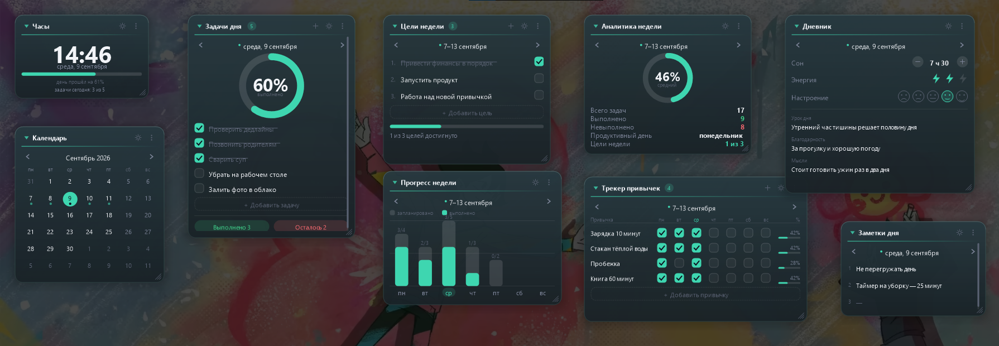

# Планер GO

Виджет для рабочего стола Windows: **планер, разобранный на блоки**. Каждый блок — отдельное
окно со своим местом, размером и оформлением, и каждый показывает ровно один кусочек планера:
часы, календарь, задачи одного дня, цели недели, диаграммы, трекер привычек, дневник, заметки.
Весь планер сразу на рабочий стол не влезет — поэтому блоки выбираются по одному, а дни
листаются стрелками. Собирается в Docker, на выходе — **один переносимый `.exe` (~380 KB)**
без единой внешней зависимости.



Коротко, что умеет:

- девять типов блоков: **Часы, Календарь, Задачи дня, Цели недели, Прогресс недели,
  Аналитика недели, Трекер привычек, Дневник, Заметки дня** — включаются и выключаются
  по одному в окне настроек;
- задачи, цели, привычки и дневник **привязаны к дате**; выбранный день общий для всех блоков,
  листается стрелками в любом блоке или кликом по дате в календаре;
- проценты, кольца и столбики **считаются сами** из задач — ничего не нужно вводить руками;
- у каждого блока своя тема (тёмная или светлая), акцент из шести цветов и непрозрачность;
- шрифт интерфейса выбирается из шести системных: Segoe UI, Bahnschrift, Calibri, Corbel,
  Verdana, Georgia — и применяется сразу ко всем блокам;
- настройки разделены: шестерёнка в заголовке — про этот блок, значок в трее — про весь планер;
- блоки лежат под окнами, как часть рабочего стола, и всплывают вместе с ним;
- размер блока тянется мышью за правый край, нижний край или уголок;
- настройки — отдельное окно с переключателями и ползунками, всё применяется сразу.

---

## Быстрый старт

```powershell
# из корня проекта
docker build --target export --output "type=local,dest=dist" .
```

Появится `dist\PlannerGo.exe`. Скопируйте его на любую Windows 10/11 машину и запустите
двойным кликом. При первом запуске появятся три блока — часы, задачи дня и цели недели;
остальные включаются в настройках или через меню «Добавить блок».

Альтернативы:

```powershell
.\scripts\build.ps1           # то же самое + проверки и размер файла
docker compose run --rm build # через docker-compose, результат тоже в dist/
```

> Перед пересборкой закройте запущенный виджет: Windows блокирует запущенный `.exe`,
> и запись в `dist/` завершится ошибкой «Access is denied».

На целевой машине **не нужны** Node.js, Python, .NET, Java, браузер, Docker и установщик.
Список библиотек, которые тянет `.exe`: `KERNEL32`, `USER32`, `GDI32`, `gdiplus`, `SHELL32`,
`ole32`, `ADVAPI32`, `msvcrt` — все они входят в состав Windows.

---

## Выбор стека

Тот же, что у виджетов 1 и 2 (`../widget 1`, `../widget 2`): C++17 + Win32 + GDI+,
кросс-компиляция MinGW-w64 из Linux-контейнера, статическая линковка, слоёное окно
(`WS_EX_LAYERED` + `UpdateLayeredWindow`) ради настоящего альфа-канала, скруглённых углов и тени.

Что появилось именно здесь:

- **Блок = тип содержимого.** Окно блока умеет одно: нарисовать карточку с заголовком и отдать
  внутренность в `panels.cpp`. Там девять функций отрисовки — по одной на тип. Добавить десятый
  блок значит дописать значение в `PanelKind` и функцию рисования, всё остальное (окно, тема,
  размер, прокрутка, меню) уже работает.
- **Одна отрисовка — одна раскладка.** Панель, пока рисует, складывает нажимаемые прямоугольники
  в `ctx.elems`: чек-бокс, стрелку, строку дневника. Попадания мыши ищутся по этому же списку,
  поэтому «нарисовано» и «нажимается» не могут разойтись — отдельного кода раскладки нет.
- **Один выбранный день на весь планер.** Дата живёт в приложении, а не в блоке. Стрелка в
  «Задачах дня», клик по числу в календаре и столбик в «Прогрессе недели» двигают одно и то же
  значение, поэтому дневник, заметки и задачи всегда показывают один и тот же день.
- **Никаких системных контролов.** Чек-боксы, кольца, столбики, смайлы настроения и молнии
  энергии — обычные фигуры GDI+. Единственное системное окно — поле ввода в диалоге.

---

## Структура проекта

```
widget 3/
├── CMakeLists.txt              сборка, флаги размера и статической линковки
├── Dockerfile                  debian + mingw-w64 -> .exe (multi-stage)
├── docker-compose.yml          вариант сборки с выводом в ./dist
├── cmake/
│   └── toolchain-mingw.cmake   кросс-компиляция Linux -> Windows x64
├── res/
│   ├── app.rc                  манифест, иконка, версия
│   ├── app.manifest            DPI-awareness, Windows 10/11
│   └── app.ico                 иконка (генерируется scripts/make-icon.ps1)
├── scripts/
│   ├── build.ps1 / build.sh    сборка через Docker
│   └── make-icon.ps1           рисует res/app.ico (System.Drawing)
├── docs/screenshot.png
└── src/
    ├── main.cpp                WinMain: единственный экземпляр, COM, GDI+, цикл сообщений
    ├── widget.cpp/.h           окна блоков и приложение: меню, трей, таймер, действия
    ├── panels.cpp/.h           содержимое блоков: девять функций отрисовки + список нажимаемого
    ├── settings.cpp/.h         окно настроек в двух режимах: блок и планер целиком
    ├── dialog.cpp/.h           модальный ввод строки (задача, цель, запись дневника)
    ├── store.cpp/.h            модель данных, сводки, чтение и запись data.json
    ├── date.cpp/.h             календарная арифметика и русские подписи дат
    ├── json.cpp/.h             минимальный JSON
    ├── sys.cpp/.h              трей, автозапуск, открытие папки
    ├── ui.cpp/.h               палитра, DPI, обёртки над GDI+ (карточка, кольцо, текст)
    └── util.cpp/.h             кодировки, пути, склонения
```

---

## Как пользоваться

### Блоки

Каждый блок живёт сам по себе: перетаскивается за заголовок или за пустое место карточки,
сворачивается кликом по заголовку, растягивается мышью за правый край, нижний край или уголок.
В заголовке три кнопки: `+` (добавить задачу, цель или привычку — смотря какой блок),
шестерёнка (настройки этого блока) и `⋮` (меню). Правая кнопка по строке списка открывает
меню самой строки.

Какие блоки показывать — выбирается в настройках, раздел «БЛОКИ НА ЭКРАНЕ»: тумблер включает
блок и он появляется на рабочем столе, выключает — блоки этого типа закрываются. То же самое
делает пункт «Добавить блок» в меню блока и в меню значка в трее.

| Блок | Что показывает |
|---|---|
| Часы | Время, дату, полосу «сколько дня прошло» и счётчик задач на сегодня |
| Календарь | Месяц целиком; точка под числом — в этот день есть задачи, клик по числу выбирает день |
| Задачи дня | Задачи выбранного дня, кольцо прогресса, итоги «выполнено / осталось» |
| Цели недели | Цели с чек-боксами и полосой достижения |
| Прогресс недели | Столбики по дням: серый — запланировано, акцентный — выполнено |
| Аналитика недели | Всего задач, выполнено, невыполнено, средний прогресс, продуктивный день, цели |
| Трекер привычек | Привычки × дни недели, галочки и процент за неделю |
| Дневник | Сон (шаг 30 минут), энергия, настроение, урок дня, благодарность, мысли |
| Заметки дня | Три короткие записи к выбранному дню |

### Выбранный день — общий

Стрелки `‹` и `›` в блоке дня двигают дату на день, в недельных блоках — на неделю. Клик по
самой дате возвращает к сегодняшнему дню (пока показан сегодняшний, слева от даты горит точка).
Клик по числу в календаре или по столбику в «Прогрессе недели» выбирает этот день сразу во всех
блоках. В полночь виджет сам переходит на новый день, если до этого показывал сегодняшний.

### Проценты считаются сами

Ничего вводить не нужно: процент дня — это выполненные задачи к общему числу задач, средний
прогресс недели — среднее по дням, где задачи есть, процент привычки — отмеченные дни к семи.
Диаграммы всех блоков перерисовываются сразу после любой галочки.

### Размер блока мышью

Правый край меняет ширину, нижний — высоту, уголок — то и другое. Уголок помечен тремя
чёрточками и подсвечивается акцентом. Если содержимое не помещается в выбранную высоту
(длинный список задач или привычек), появляется тонкая полоса прокрутки и список крутится
колесом мыши. Блоки-диаграммы (часы, календарь, столбики, аналитика) не прокручиваются, а
подстраиваются под размер: цифры часов растут вместе с блоком, клетки календаря — тоже.

### Настройки — два окна вместо одного

Настройки одного блока и настройки всего планера разведены, чтобы не искать нужное среди
чужого. Всё применяется сразу, кнопки «ОК» нет.

**Настройки блока** — шестерёнка в заголовке блока или пункт меню «Настройки блока…»:

- **Оформление блока** — тёмная или светлая тема, шесть акцентов, непрозрачность 40–100 %.
  Ссылка «Применить оформление ко всем блокам» раздаёт эти три настройки остальным.
  Прозрачность гасит только фон карточки — текст, галочки и диаграммы остаются чёткими.
  У неё есть предел: сквозь совсем прозрачную светлую карточку видны обои, и тёмный текст на
  тёмных обоях перестаёт читаться, поэтому на минимуме фон остаётся самым прозрачным из
  читаемых, а приглушённые подписи подтягиваются по контрасту к основному тексту.
- **Содержимое блока** — «Диаграммы» (кольца, столбики, точки) и «Итоги» (строки под
  содержимым) выключаются, если нужен совсем компактный блок; «Закрепить блок» запрещает
  двигать и растягивать его мышью.
- Внизу — ссылка «Общие настройки планера…», чтобы перейти во второе окно.

**Настройки планера** — **клик по значку в трее** (он же пункт «Настройки планера…» в меню
блока и в меню значка):

- **Блоки на экране** — девять тумблеров с подсказками: включил тумблер, блок появился на
  рабочем столе; выключил — блоки этого типа закрылись.
- **Шрифт** — шесть системных семейств, каждое написано в списке само собой, так что выбирать
  можно на глаз. Шрифт общий для всех блоков и для самого окна настроек; кегли выровнены
  коэффициентом, поэтому блоки не «прыгают» при смене.
- **Общее** — магнит при перетаскивании, «поверх всех окон», секунды в часах, автозапуск,
  горячая клавиша Ctrl+Alt+P (показать/скрыть все блоки).
- **Данные** — папка с данными и резервные копии.
- Кнопка внизу — «Расставить блоки по экрану»: раскладывает все окна сеткой от левого верхнего
  угла, если они разъехались.

### Блоки как часть рабочего стола

По умолчанию блок — **дочернее окно самого рабочего стола** (`Progman`): не просто лежит под
чужими окнами, а физически находится внутри стола, рядом со значками. Отсюда всё остальное:
блок никогда не всплывает над проводником, браузером или игрой — даже когда по рабочему столу
кликнули мышью или это второй монитор; при «Показать рабочий стол» (Win+D) он виден вместе со
столом; в Alt+Tab не появляется. Если планер нужен всегда на виду, включите «Поверх всех окон» —
блок снова станет обычным окном верхнего уровня.

Плата за это — две вещи, которые пришлось взять на себя:

- **окно двигает не система, а виджет.** Дочерние окна `WM_NCLBUTTONDOWN`/`HTCAPTION` не
  переносит, поэтому перенос и растягивание ведёт таймер: пока нажата левая кнопка, виджет сам
  читает курсор и двигает окно. Захват мыши (`SetCapture`) тут не помощник — у неактивного окна
  он работает, лишь пока курсор над ним, а при переносе курсор постоянно оказывается за краем;
- **диалоги и меню принадлежат скрытому окну приложения.** Сделать владельцем блок нельзя:
  владельцем стал бы рабочий стол, и на время диалога он оказался бы отключён. Диалог при этом
  всё равно центрируется по блоку, из которого его позвали, а сами блоки на это время мышь
  не принимают.

Две мелочи, дорого давшиеся:

- сообщение оболочке «перестрой слой обоев» (`0x052C`) слать **не нужно**: оно заставляет
  рабочий стол перерисоваться, и блоки поверх него заметно мерцают;
- при смене родителя слоёное окно перестаёт показываться, пока `WS_EX_LAYERED` не выставлен
  заново. Без этого блок после переключения «Поверх всех окон» выглядит исчезнувшим: окно на
  месте, «видимо», но полностью прозрачно. Поэтому переезд идёт через один метод `Reparent`:
  стиль → `SetParent` → пересборка `WS_EX_LAYERED` → `ShowWindow` → отрисовка.

Alt+F4 по блоку не закрывает планер, а прячет все блоки в трей — оттуда они возвращаются
пунктом «Показать все блоки» в меню значка (правая кнопка) или горячей клавишей Ctrl+Alt+P.
Левая кнопка на значке открывает общие настройки.

---

## Где лежат данные

```
%APPDATA%\PlannerGo\
├── data.json            блоки, дни, недели, привычки, настройки
└── backups\             копия data.json на каждый день, последние 7
```

`data.json` — обычный UTF-8 JSON, его можно читать и править руками (виджет при этом лучше
закрыть). Запись атомарная: сначала `data.json.tmp`, потом подмена файла, поэтому сбой питания
не оставит обрезанный файл. Раз в сутки перед записью откладывается копия в `backups\`.

Пустые дни и недели при сохранении выбрасываются: если в дне не осталось ни задач, ни отметок,
ни записей дневника, он просто исчезает из файла — от одних только заходов файл не растёт.

Формат:

```json
{
  "panels": [ { "kind": 2, "x": 320, "y": 10, "width": 300, "height": 400,
                "theme": "dark", "accent": 0, "opacity": 100 } ],
  "habits": [ { "id": 1, "name": "Зарядка 10 минут" } ],
  "days": [ { "date": "2026-09-09",
              "tasks": [ { "text": "Сварить суп", "done": true } ],
              "notes": ["Не перегружать день", "", ""],
              "habits": [1, 2],
              "journal": { "sleep": 450, "energy": 2, "mood": 4,
                           "lesson": "…", "gratitude": "…", "thoughts": "…" } } ],
  "weeks": [ { "monday": "2026-09-07",
               "goals": [ { "text": "Запустить продукт", "done": false } ] } ]
}
```

`kind` — тип блока: 0 часы, 1 календарь, 2 задачи дня, 3 цели недели, 4 прогресс недели,
5 аналитика, 6 привычки, 7 дневник, 8 заметки. `sleep` — минуты сна, `energy` — 0–3,
`mood` — 0–5.

### Автозапуск

Тумблер в настройках пишет `HKCU\Software\Microsoft\Windows\CurrentVersion\Run\PlannerGo` —
права администратора не нужны. Если `.exe` переехал, запись перестаёт совпадать с текущим путём
и тумблер честно показывает «выключено»: включите заново.

---

## Что проверено

- Сборка в контейнере проходит без предупреждений (`-Wall -Wextra`), размер `.exe` — 382 KB.
- Все девять блоков рисуются и считают проценты на неделе с задачами, привычками и дневником.
- Добавление задачи через диалог: счётчик в заголовке, кольцо прогресса, столбик недели и
  подпись в часах пересчитались одновременно.
- Галочка в списке, переключение темы на светлую и смена акцента применяются мгновенно.
- Растягивание блока мышью за уголок: цифры часов выросли вместе с блоком, размер сохранился
  в `data.json`.
- Данные переживают перезапуск: задачи, отметки, размеры и оформление читаются обратно.
- Непрозрачность 40 % в светлой и в тёмной теме: текст, галочки и итоги читаются на пёстрых обоях.
- Клик по значку в трее открывает общие настройки; смена шрифта на Calibri перерисовала все
  блоки и само окно настроек.

---

## Идеи для следующей версии (не реализованы)

- Перенос задачи мышью между днями (сейчас — пункт меню «Перенести на завтра»).
- Повторяющиеся задачи и шаблон дня.
- Экспорт недели в текст или CSV для отчёта.
- Напоминания: всплывающее уведомление о невыполненных задачах вечером.
- Заметки длиннее строки — с переносом и раскрытием блока.
