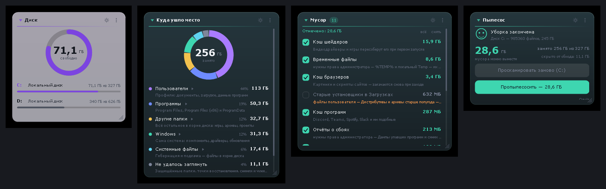

# Диск-пылесос (DiskVac) — виджет 4

Виджет рабочего стола, который отвечает на вопрос «куда делось место на диске» и выносит
мусор. Показывает диск кольцом, раскладывает занятое по долям, находит самые тяжёлые папки
и файлы, давно забытые файлы, хвосты удалённых программ — и чистит то, что отмечено
галочками.



Четвёртый виджет серии `desktop_widget`. Стек тот же, что у остальных: C++17 + Win32 +
GDI+, слоёные окна, кросс-компиляция MinGW-w64 в Docker, на выходе один статически
слинкованный `.exe` без зависимостей.

---

## Быстрый старт

```powershell
.\scripts\build.ps1        # соберёт dist\DiskVac.exe (нужен Docker Desktop)
.\dist\DiskVac.exe         # запуск: двойной клик по файлу
```

Готовый `.exe` уже лежит в `dist\`. Установка не нужна, в реестр виджет пишет только
запись автозапуска — и только если её включить.

Первый заход: нажать **«Просканировать диск C:»** в блоке «Пылесос». Полный обход
системного диска занимает 2–5 минут, всё это время виджетом можно пользоваться — обход
идёт в отдельном потоке с пониженным приоритетом.

---

## Блоки

Каждый блок — отдельное окно на рабочем столе со своим размером, местом и оформлением.
Набор блоков выбирается в настройках (левый клик по значку в трее) или в меню блока.

| Блок | Что показывает |
|---|---|
| **Пылесос** | Кнопка запуска, ход работы, сколько мусора нашлось, кнопка уборки, ссылка на отчёт |
| **Диск** | Кольцо «занято / свободно», список дисков — кликом выбирается тот, что разбираем |
| **Куда ушло место** | Кольцо из долей: Windows, программы, профили, системные файлы, «не удалось заглянуть». Клик по строке легенды раскрывает, из чего доля состоит |
| **Папки-тяжеловесы** | Самые тяжёлые папки со столбиками; клик открывает папку в проводнике |
| **Большие файлы** | Крупные файлы с путями; правая кнопка — «показать в проводнике», «свойства», «в корзину» |
| **Мусор** | Группы мусора с галочками и кнопкой «Пропылесосить» |
| **Давно не открывали** | Большие файлы, которых не касались дольше заданного срока |
| **Хвосты программ** | Папки, для которых не нашлось установленной программы |
| **Системные файлы** | Гибернация, подкачка, хранилище компонентов, точки восстановления — и чем каждое управляется в Windows |

Управление то же, что в остальных виджетах серии: заголовок тянет окно и сворачивает блок
по клику, правый нижний угол меняет размер, шестерёнка — настройки блока, «⋮» — меню,
`Ctrl+Alt+D` прячет и возвращает все блоки.

---

## Что виджет удаляет, а что нет

Удаление устроено двумя разными способами, и это принципиально:

- **кэши и временные файлы удаляются сразу** — их Windows и программы создают заново,
  а через корзину место бы не освободилось (на том же диске корзина — это просто
  перемещение);
- **файлы пользователя уезжают в корзину** — отдельные файлы из списков, «Старые
  установщики в Загрузках». Их можно вернуть, но место освободится только после очистки
  корзины. Виджет об этом пишет прямо в окне подтверждения.

Группы мусора, помеченные как «файлы пользователя», виджет **никогда не отмечает сам** —
только вручную, и подтверждение для них отдельное, с предупреждением.

**Что виджет не трогает никогда:** `Windows\WinSxS`, `Windows\Installer`,
`System Volume Information`, `pagefile.sys`, `hiberfil.sys`, точки восстановления. Это
место тоже показано — в блоке «Системные файлы», вместе с подсказкой, какой настройкой
Windows его уменьшает. Удалять такое руками нельзя: система после этого либо перестаёт
обновляться, либо не загружается.

### Группы мусора

Временные файлы (`%TEMP%`, `Windows\Temp`), корзина, кэш обновлений Windows и кэш их
раздачи, кэш браузеров (Chrome, Edge, Firefox, Yandex, Opera, Brave, Vivaldi), кэш
программ (Discord, Teams, Spotify, Slack, VS Code, JetBrains), эскизы проводника, кэш
шейдеров (NVIDIA, AMD, D3D, Steam), отчёты о сбоях и очереди WER, журналы Windows,
`Windows.old`, старые установщики в «Загрузках».

Правила лежат в одном месте — `src/junk.cpp`. Один и тот же список используется и для
подсчёта, и для очистки: показать одно, а удалить другое было бы нечестно.

---

## Почему «занято» больше, чем сумма папок

Виджет честно показывает долю **«Не удалось заглянуть»** — разницу между тем, что Windows
считает занятым, и тем, что удалось обойти. Туда попадают:

- точки восстановления и теневые копии (`System Volume Information`) — часто десятки ГБ;
- защищённые системные папки, куда не пускают без прав администратора;
- профили других пользователей.

Если запустить виджет от администратора (ссылка в блоке «Пылесос»), эта доля заметно
уменьшается: закрытых папок становится меньше.

---

## Настройки

Левый клик по значку в трее — общие настройки: блоки на экране, какой диск разбираем,
правила поиска (с какого размера файл считается большим, с какого возраста — старым и
хвостом программы), шрифт, магнит, «поверх всех окон», автозапуск, горячая клавиша,
сканирование при запуске, подтверждение перед удалением.

Шестерёнка в заголовке блока — настройки самого блока: тема, акцент, непрозрачность,
диаграммы, пояснения, закрепление. У каждого блока оформление своё: рядом могут стоять
тёмный и светлый.

Данные виджета: `%APPDATA%\DiskVac\data.json`, текстовый отчёт о последнем сканировании —
`%APPDATA%\DiskVac\отчёт.txt` (открывается ссылкой «Отчёт»).

---

## Как устроен код

| Файл | Зачем |
|---|---|
| `main.cpp` | Точка входа, единственный экземпляр, COM и GDI+ |
| `widget.cpp` | Окна блоков, перенос и размер мышью, меню, трей, связка со сканером |
| `panels.cpp` | Содержимое блоков: рисует и попутно собирает, по чему можно кликнуть |
| `scan.cpp` | Обход диска в фоновом потоке, доли, списки, хвосты программ, очистка |
| `junk.cpp` | Правила «что считать мусором» — один список для подсчёта и для удаления |
| `store.cpp` | Блоки и настройки в `data.json`, текстовый отчёт |
| `settings.cpp` | Окно настроек (своё, на GDI+, в двух режимах) |
| `dialog.cpp` | Модальный ввод строки |
| `sys.cpp` | Автозапуск, трей, проводник, корзина, права администратора |
| `ui.cpp` | Палитра, темы, DPI, обёртки над GDI+ |
| `util.cpp` | Кодировки, пути, размеры, возраст файлов |
| `json.cpp` | Минимальный JSON |

Три вещи, которые стоит знать, прежде чем править:

1. **Блок — дочернее окно рабочего стола.** Виджет ищет окно-хозяина значков
   (`SHELLDLL_DefView`) и делает `SetParent` на него: так блоки не всплывают над чужими
   окнами и видны по `Win+D`. Из этого следует, что систему нельзя попросить двигать окно
   за заголовок — перенос и растягивание ведёт таймер, а меню и диалоги живут на скрытом
   окне верхнего уровня.

2. **Сканер живёт в своём потоке.** Окна берут у него только копии: `Snapshot()` для
   результата и `CurrentProgress()` для хода работы. Рисовать по живым данным нельзя —
   их в этот момент дописывают. Поток сообщает о себе сообщениями окну приложения.

3. **Отрисовка и попадания мыши — один проход.** Панель рисует строку и тут же кладёт её
   прямоугольник в `ctx.elems`. Поэтому нажимается ровно то, что нарисовано, и отдельной
   раскладки для мыши не существует.

---

## Сборка

```powershell
.\scripts\build.ps1              # Docker Desktop, результат в dist\
```

```sh
./scripts/build.sh               # то же самое из Git Bash / Linux / macOS
docker compose run --rm build    # альтернатива через compose
```

Иконка генерируется отдельно и лежит в репозитории готовой (`res/app.ico`), потому что
сборка идёт в Linux-контейнере, где `System.Drawing` недоступен:

```powershell
.\scripts\make-icon.ps1
```

Библиотеки — только те, что есть в самой Windows: `gdiplus`, `gdi32`, `user32`, `shell32`,
`ole32`, `advapi32`. Линковка статическая, на целевой машине ничего доустанавливать не
нужно. Windows 10 и 11, x64.
