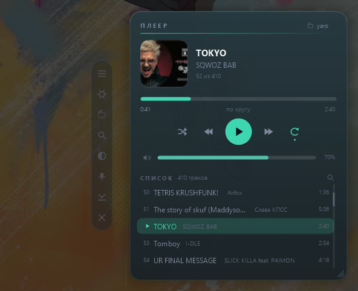

# Плеер (TuneBox) — виджет 5

Виджет рабочего стола, который играет музыку из выбранной папки. Один блок: обложка,
название и исполнитель, полоса с перемоткой, кнопки, громкость и список треков, по
которому можно щёлкнуть и услышать нужное.



Пятый виджет серии `desktop_widget`. Стек тот же, что у остальных: C++17 + Win32 + GDI+,
слоёное окно, кросс-компиляция MinGW-w64 в Docker, на выходе один статически слинкованный
`.exe` без зависимостей. Звук — Media Foundation, то есть тот же движок, что у
проигрывателя Windows: играет всё, для чего в системе есть кодек.

---

## Быстрый старт

```powershell
.\scripts\build.ps1        # соберёт dist\TuneBox.exe (нужен Docker Desktop)
.\dist\TuneBox.exe         # запуск: двойной клик по файлу
```

Готовый `.exe` уже лежит в `dist\`. Установка не нужна, в реестр виджет пишет только
запись автозапуска — и только если её включить.

При первом запуске плеер берёт папку музыки пользователя (`C:\Users\<имя>\Music`) и сразу
показывает, что в ней нашлось. Другую папку выбирают кнопкой **«Выбрать папку»** на панели
слева, надписью с именем папки в правом верхнем углу блока или в настройках.

За папкой плеер следит сам: треки, которые добавили, удалили или переименовали в проводнике,
появляются в списке примерно через полторы секунды после того, как копирование закончилось.
Играющий трек при этом не прерывается, а теги перечитываются только у изменившихся файлов.

---

## Что умеет

| Действие | Как |
|---|---|
| Играть / пауза | Большая круглая кнопка, клик по обложке, `Ctrl+Alt+P`, кнопка «играть» на клавиатуре |
| Следующий / предыдущий | Кнопки `⏩` `⏪`, `Ctrl+Alt+→` и `Ctrl+Alt+←`, мультимедийные клавиши |
| Перемотка | Тянуть полосу прогресса. Пока тянешь, время под полосой показывает, куда попадёшь |
| Громкость | Ползунок рядом со значком, колесо мыши над блоком, `Ctrl+Alt+↑` и `Ctrl+Alt+↓` |
| Перемешать | Кнопка `🔀` — порядок треков перетасовывается, текущий остаётся на месте |
| Одно по кругу | Кнопка `🔁` переключает три состояния: выключено → весь список по кругу → один трек по кругу. Что выбрано, написано словами под полосой прогресса |
| Конкретный трек | Клик по строке списка. Список прокручивается колесом мыши и полосой справа |
| Найти трек | Лупа в заголовке списка или `Найти трек…` в меню: список фильтруется по названию, исполнителю, альбому и имени файла. Если нашёлся ровно один — он сразу включается |
| Трек не из папки | `Открыть трек…` в меню: проигрывается любой файл, список при этом не трогается |
| Показать файл | Двойной клик по строке — трек откроется в проводнике с выделением |

Плеер помнит, на чём остановились: при следующем запуске тот же трек открывается на той же
секунде и стоит на паузе. Если хочется, чтобы музыка начиналась сразу, — переключатель
«Играть сразу при запуске» в настройках.

### Названия и обложки

Название, исполнителя, альбом и длительность плеер берёт из тегов файла — теми же
средствами, какими их читает проводник, поэтому в блоке видно ровно то же, что в его
столбцах. Обложка — встроенная картинка из тега; если её нет, рисуется нота.

Теги читает фоновый поток с пониженным приоритетом: папка на несколько сотен файлов
появляется в блоке сразу, а подписи и длительности дозаполняются за пару секунд. Пока это
идёт, рядом с именем папки стоит «…».

У скачанной музыки теги бывают пустыми, зато имя файла осмысленное. Для таких папок в
настройках есть выбор, **как читать имя файла**:

- **Сначала теги** — название и исполнитель из тегов, имя файла подставляется, только если
  тегов нет (по умолчанию);
- **Исполнитель — Название** — `Era - Ameno.mp3` читается как «Ameno» исполнителя «Era»;
- **Название — Исполнитель** — `Ameno - Era.mp3` читается так же, но половинки наоборот.

Разделителем считается только ` - ` с пробелами: дефис внутри слова (`Ne-Yo`, `поп-музыка`)
не разрывается.

### Форматы

`.mp3`, `.m4a`, `.m4b`, `.aac`, `.adts`, `.wav`, `.wma`, `.flac`, `.mp4`, `.ac3`, `.aif`,
`.aiff`. Список не «наш», а системный: воспроизведение идёт через Media Foundation, так что
работает всё, что открывается в проигрывателе Windows. Файл без кодека или битый не
останавливает музыку — плеер пишет причину под названием и переходит к следующему треку.

---

## Управление блоком

Блок — отдельное окно на рабочем столе, приклеенное к нему: он не всплывает над чужими
окнами, но виден вместе со столом, в том числе по `Win+D`. Переключатель «Поверх всех окон»
превращает его в обычное окно верхнего уровня.

- **перенос** — тянуть за пустое место карточки;
- **размер** — правый край меняет ширину, нижний — число строк списка, уголок — то и другое.
  Уголок помечен тремя чёрточками;
- **панель слева** — восемь кнопок: меню, настройки, выбор папки, поиск, тема, «поверх всех
  окон», свернуть в трей, закрыть. Пока курсора нет, панель бледная; при наведении на кнопку
  слева от неё появляется подпись;
- **правая кнопка** по блоку — полное меню;
- **значок в трее** — левый клик открывает настройки, правый даёт короткое меню, двойной
  скрывает и возвращает блок.

## Настройки

Отдельное окно, нарисованное теми же средствами, что и блок: переключатели, ползунки,
выбор темы и акцента. Открывается шестерёнкой на панели, пунктом «Все настройки…» в меню и
левым кликом по значку в трее. Всё применяется сразу, без «ОК».

Что там есть: папка и обход подпапок, разбор имени файла, перемешивание, режим повтора,
громкость, восстановление позиции, тема, акцент (шесть цветов), непрозрачность, ширина
блока, число строк списка, обложка, список, закрепление блока, шрифт (шесть системных),
«поверх всех окон», горячие клавиши, мультимедийные клавиши, автозапуск с Windows.

У непрозрачности есть пол: совсем прозрачная карточка светлой темы показывала бы обои
насквозь, и тёмный текст на тёмных обоях перестал бы читаться. Поэтому гасится только фон —
текст, обложка и полосы остаются чёткими.

Настройки лежат в `%APPDATA%\TuneBox\data.json`, папку открывает пункт «Папка с
настройками».

---

## Как устроен код

| Файл | За что отвечает |
|---|---|
| `main.cpp` | WinMain, единственный экземпляр, COM и GDI+ |
| `widget.cpp` | Окно блока: раскладка, отрисовка, мышь, меню, трей, горячие клавиши, порядок воспроизведения |
| `settings.cpp` | Окно настроек (список элементов → раскладка → отрисовка), общается с блоком через `settings::Host` |
| `audio.cpp` | Media Foundation: сессия, топология, старт/пауза/перемотка/громкость |
| `library.cpp` | Обход папки и чтение тегов в фоновом потоке, наружу — только копии списка |
| `cover.cpp` | Обложка как эскиз файла через `IShellItemImageFactory`, с кэшем |
| `store.cpp` | `data.json`: чтение, запись через временный файл |
| `dialog.cpp` | Модальный ввод (поиск трека) |
| `ui.cpp` | Палитра, темы, акценты, шрифты, обёртки над GDI+ |
| `util.cpp`, `json.cpp`, `sys.cpp` | Кодировки и пути, минимальный JSON, трей/автозапуск/диалоги выбора |

### Почему события Media Foundation разбираются в таймере

У сессии Media Foundation обычно слушают события через `IMFAsyncCallback` в своём потоке.
Здесь вместо этого `audio::Pump()` дёргает `GetEvent(MF_EVENT_FLAG_NO_WAIT)` из того же
таймера, который двигает полосу прогресса. Так весь плеер живёт на одном потоке: не нужны
ни блокировки, ни реализация COM-интерфейса, а состояние кнопок всегда совпадает с тем, что
показано на экране.

Единственное место, где ждать нельзя, — сам момент нажатия: между `SetTopology` и стартом
проходит несколько миллисекунд, и если ждать тика таймера, звук появлялся бы с задержкой.
Поэтому `Open()` сам прокручивает очередь событий, но не дольше ~700 мс — если за это время
топология не собралась, дело доделает таймер.

### Почему на каждый трек создаётся новая сессия

Презентационные часы сессии идут монотонно: они не обнуляются ни при смене топологии, ни
явной позицией в `Start`. С одной сессией на всё время работы второй трек начинал отсчёт с
той секунды, где кончился первый, — полоса ехала по чужому времени, а перемотка на минуту
попадала на 64-ю секунду. Свежая сессия начинает с нуля, и позиция трека совпадает с
показаниями часов. Переключение занимает 31–47 мс, на слух это стык между треками.

Чинить это остановкой сессии нельзя: остановленная сессия откладывает разрешение новой
топологии до `Start`, событие готовности не приходит вовсе, и трек навсегда остаётся
«открывающимся» — кнопка «играть» молча перестаёт работать. На такой случай в `Pump()`
оставлена страховка: состояние «открываю», которое держится дольше четырёх секунд,
превращается в честное сообщение об ошибке.

### Почему панель кнопок видна всегда

У слоёного окна попадание мыши определяется по альфе: сквозь полностью прозрачные пиксели
курсор «проваливается» на рабочий стол. Панель, спрятанную до наведения, нельзя было бы
навести — поэтому она нарисована всегда, пусть и бледно, а при наведении становится
плотной и подписанной.

### Почему перенос и растягивание ведёт таймер

Блок — дочернее окно рабочего стола, а такие окна система мышью не двигает:
`WM_NCLBUTTONDOWN`/`HTCAPTION` для них не работает, а `SetCapture` у неактивного окна
держит мышь только пока курсор над окном. Поэтому от нажатия до отпускания мышь ведёт
таймер на 15 мс, читая `GetAsyncKeyState` и `GetCursorPos`. Тем же способом работают
перемотка, ползунок громкости и полоса прокрутки списка.

Меню, диалоги, трей и горячие клавиши живут на скрытом окне верхнего уровня: владельцем
дочернего окна стал бы сам рабочий стол.

---

## Сборка

```powershell
.\scripts\build.ps1                     # Windows + Docker Desktop
```

```sh
./scripts/build.sh                      # Linux / macOS / Git Bash
docker compose run --rm build            # или так, .exe окажется в ./dist
```

Иконка собирается отдельно и лежит в репозитории — в Linux-контейнере `System.Drawing`
недоступен:

```powershell
.\scripts\make-icon.ps1                 # перерисует res\app.ico
```

Размер готового файла — около 385 КБ. Никаких DLL рядом не нужно: `libstdc++`, `libgcc` и
`winpthread` вкомпилированы внутрь, а всё остальное (GDI+, оболочка, Media Foundation) есть
в самой Windows.
